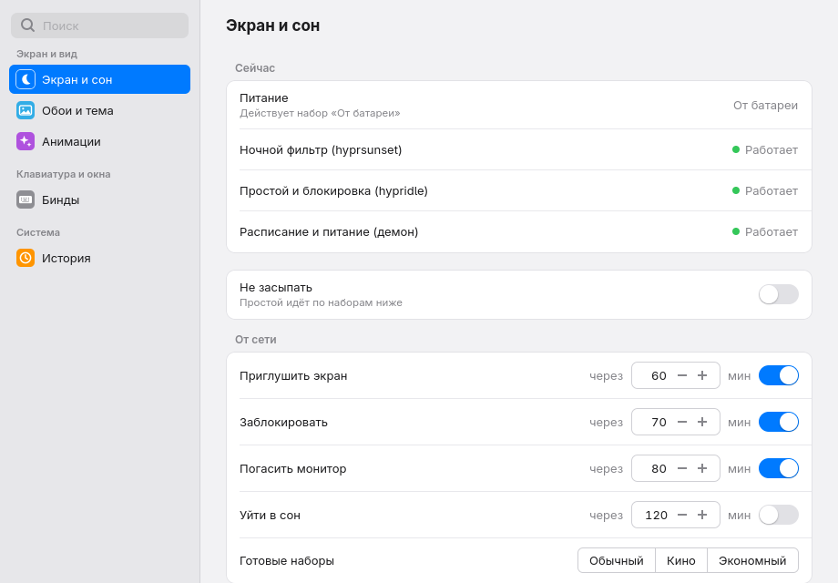
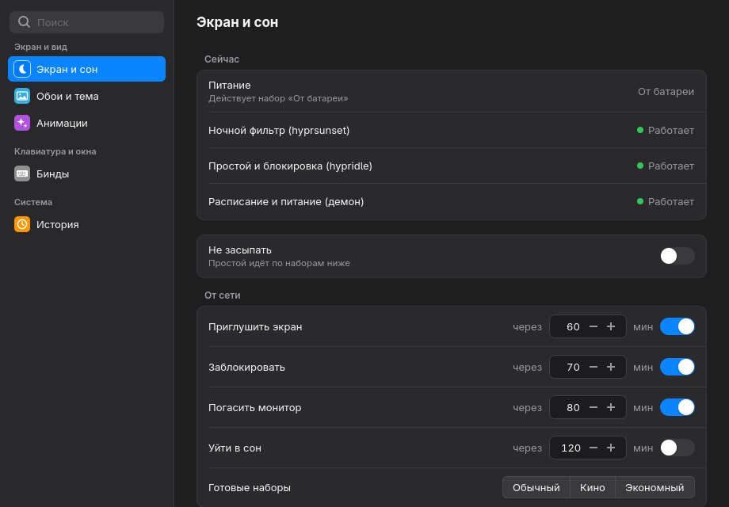
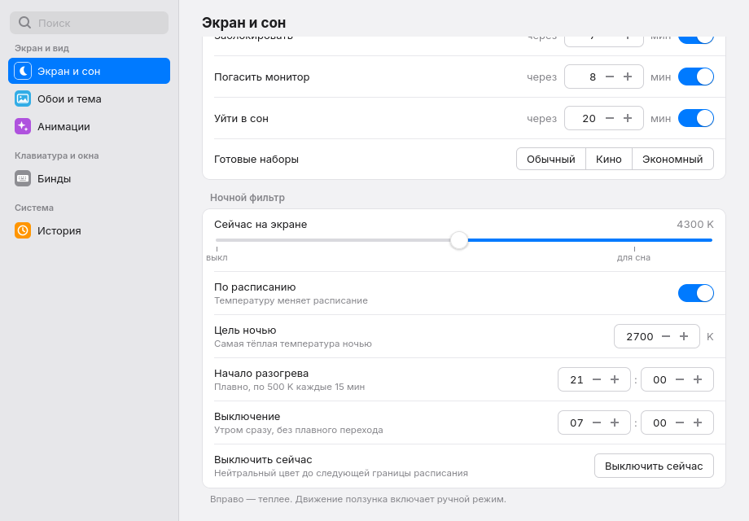
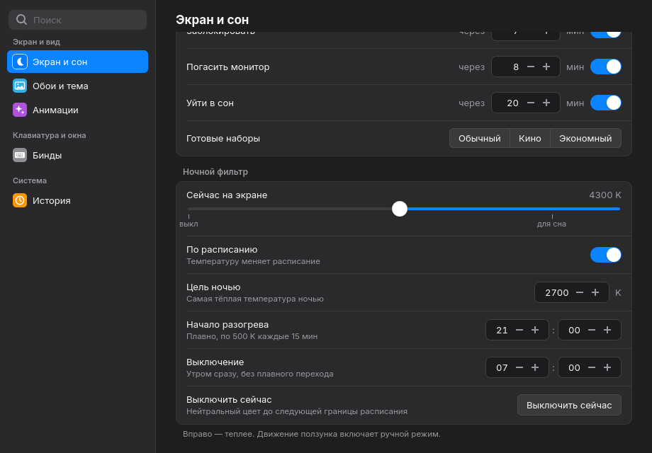
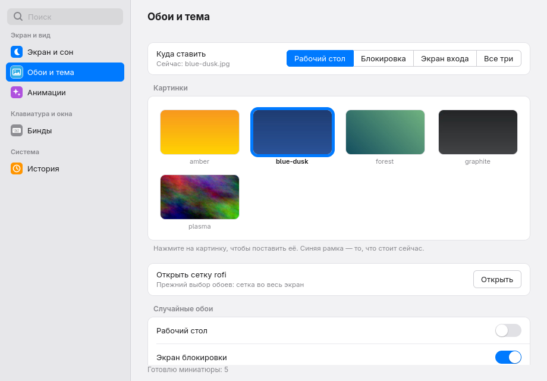
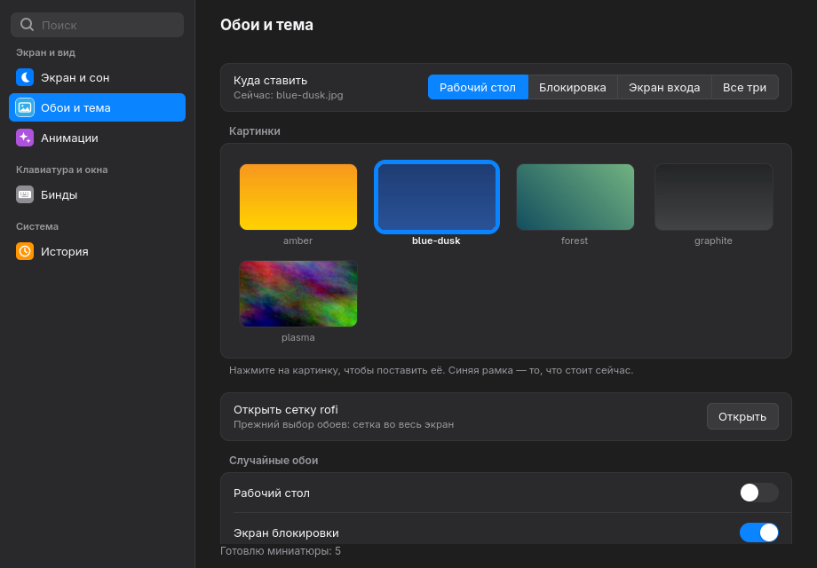
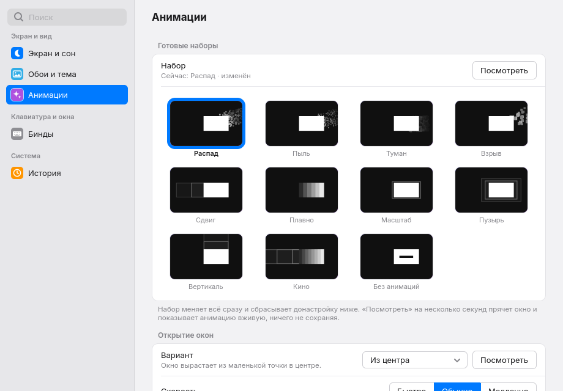
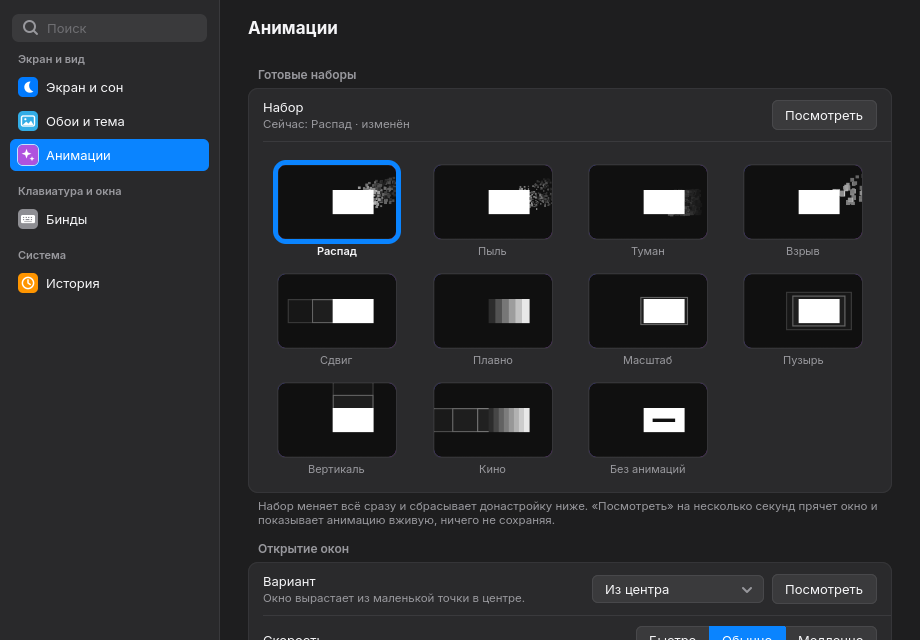
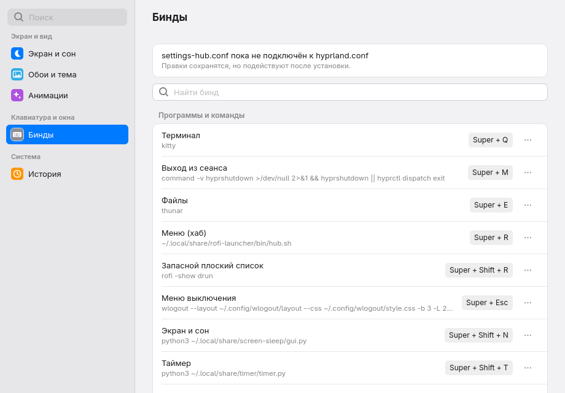
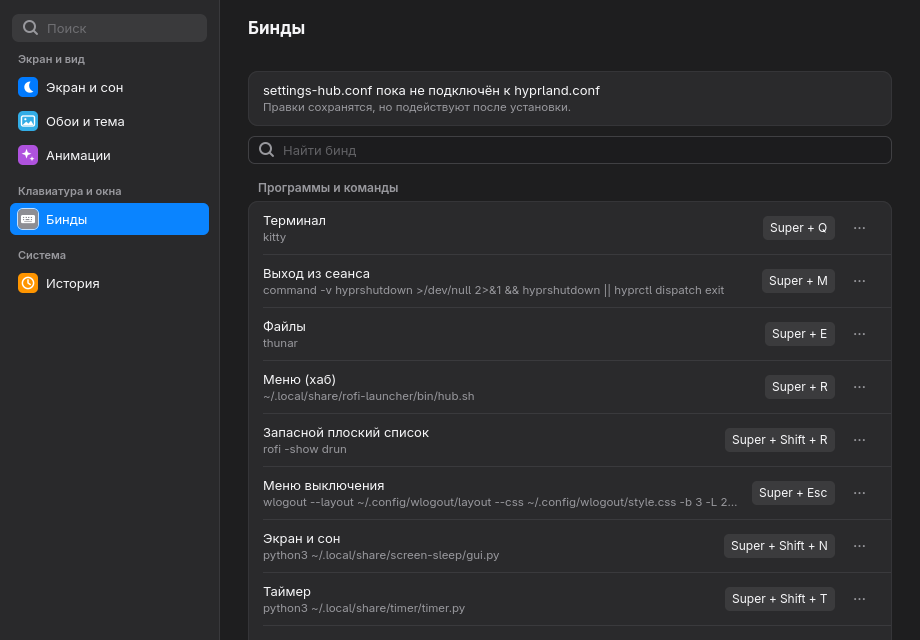

# settings-hub

A macOS-style **Settings** window for a Hyprland desktop, written in Python with
GTK4 and its own stylesheet (no libadwaita look). It stays resident in the
background, so a hotkey shows it in well under half a second, and it brings the
desktop's scattered settings windows together in one place.

The interface is in Russian; all user-facing text lives in
[`settings_hub/strings.py`](settings_hub/strings.py).

| Light | Dark |
|---|---|
|  |  |
|  |  |
|  |  |
|  |  |
|  |  |

## Status

Done so far: the **framework** and the pages **Screen and sleep**, **Wallpaper
and theme**, **Animations**, **Binds**, **Game binds**, **Windows and look**, **Keyboard and
mouse**, **General**, **System**, **Sound**, **Network and Bluetooth**, **Power
and brightness**, **Modes** and **History**. Values on Windows and look and
Keyboard and mouse apply at once (`hyprctl eval`) and persist in
`~/.config/hypr/settings-hub-vars.lua`; persistence needs a Lua config (Hyprland
0.57+). **Game binds** turns chosen key combinations (Super+V, Super+D...) off
while a game window is focused: Hyprland itself does it from
`~/.config/hypr/settings-hub-games.lua` (`hl.unbind` on focus, `hyprctl reload
config-only` when focus leaves), so it works with the window closed; Lua config
only. The framework:

- the resident application, the window (sidebar with search and coloured
  icons, rounded groups of rows), light and dark looks, keyboard control;
- search over pages (case-insensitive, `yo`/`ye`, wrong keyboard layout);
- the change history with undo (one user action = one group of items);
- loading of other projects' live modules under private names, and one
  apply-queue thread per backend;
- `settings-open`, the hotkey entry point, with every fallback;
- an installer and uninstaller (live, dry run, sandbox).

## Screen and sleep

The page replaces screen-sleep's old GTK3 window (`gui.py`, still installed as
the fallback) and drives the same live modules (`common`, `idle`, `night` in
`~/.local/share/screen-sleep`), loaded by file path under private names.

- Changes apply at once, like macOS. Idle timings and night settings are
  written 1.5 s after the last change: a fresh `load_config()`, the changed
  fields set, `save_config()`; if a field of the set for the current power
  source changed, `idle.apply_profile()` follows (the power source is checked
  again right before). All writes and hypridle restarts run on one worker
  thread, so they never overlap; queued restarts collapse into one.
- The *now* slider applies the temperature 120 ms after a change. A series of
  moves ends when the value has been still for 600 ms, the button is released
  or the slider loses focus; then manual mode is saved and the series becomes
  one History entry. Moving the slider turns *On schedule* off; turning it on
  clears manual mode and sets the scheduled temperature right away.
- The page re-reads everything when shown and every 5 s while visible (the
  daemon changes `manual_override` on its own), but never overwrites a field
  with a queued write, a focused field, or one changed in the last 10 s.
- *Stay awake* runs in a short helper process (`python3 -I
  settings_hub/helpers/caffeine.py on|off`), so `systemd-inhibit` never
  becomes a child of the resident window.
- Without `~/.config/screen-sleep/config.json` the page does not create it
  (screen-sleep's own first-run migration needs its original import layout);
  it offers a button that opens the old window once.
- Every change is a History item; undo and "return to a moment" restart
  hypridle at most once.

What the old window could do, and where it is on the new page (widget ids
from `settings_hub/controllers/screen_sleep.py`; `tests/test_screen_sleep.py`
checks this table against them, and the GUI test checks the page builds each):

| Point | Ability of the old window | Widgets of the new page |
|---|---|---|
| 1 | Two sets of idle timings, AC and battery, four steps each: on/off and minutes 1-600 | `idle.ac.dim.enabled` `idle.ac.dim.minutes` `idle.ac.lock.enabled` `idle.ac.lock.minutes` `idle.ac.dpms.enabled` `idle.ac.dpms.minutes` `idle.ac.suspend.enabled` `idle.ac.suspend.minutes` `idle.battery.dim.enabled` `idle.battery.dim.minutes` `idle.battery.lock.enabled` `idle.battery.lock.minutes` `idle.battery.dpms.enabled` `idle.battery.dpms.minutes` `idle.battery.suspend.enabled` `idle.battery.suspend.minutes` |
| 2 | Presets Normal / Movie / Saver | `idle.ac.preset.normal` `idle.ac.preset.movie` `idle.ac.preset.eco` `idle.battery.preset.normal` `idle.battery.preset.movie` `idle.battery.preset.eco` |
| 3 | Stay awake | `caffeine.switch` |
| 4 | Night filter: *now* slider 2000-6500 K with marks, *target at night* (2000-6500, step 100), warm-up start and off times, *turn off now*, Save returns to the schedule | `night.slider` `night.value` `night.target` `night.on.hour` `night.on.minute` `night.off.hour` `night.off.minute` `night.off-now` `night.schedule` |
| 5 | Moving the slider switches to manual mode | `night.slider` `night.schedule` |
| 6 | hyprsunset / hypridle / daemon checks; warning when steps are not in ascending order | `status.hyprsunset` `status.hypridle` `status.daemon` `status.power` `idle.ac.order-warning` `idle.battery.order-warning` |

## Wallpaper

Only the existing command-line tools are called (on worker threads):
`~/.config/hypr/scripts/wallpaper.sh set <desktop|lock|sddm|all> FILE`,
`wallpaper.sh random <target> on|off`, `wallpaper.sh pick` (the old rofi grid).
What is on
each target is read from `~/.local/state/hypr-wallpaper/<target>.path` and
`random.conf`.

- A target switch (desktop / lock screen / login screen / all three), then a
  grid of the library `~/.config/hypr/wallpapers/`; a click applies at once.
- Thumbnails share the rofi picker's cache `~/.cache/wallpaper-thumbs` (same
  key, `sha1(path|mtime)[:16]`, 480 px); missing ones are made by `magick` on a
  worker, and decoded off the GTK thread.
- Random wallpapers per target. (The wallpaper-driven theme moved to the Themes
  page; old `theme.mode` History entries still undo.)
- History: `wallpaper.<target>` (a path), `random.<target>`.
  Choosing a picture also logs random mode it switched off, in the same group.
  Undo restores the picture first, then random mode. Restoring "random on"
  makes the script show a new random picture: that is what random mode does.


## Themes

The whole system's colour theme in one click, plus per-program themes. All the
work is done by `wallpaper-theme` (the wallpaper-theme project); the page calls
`themes --json`, `state --json`, `theme <id>`, `target <program> <id|system>`,
`wallpapers on|off`, `random`, `custom-save`, `custom-delete`, `walls`, `walls-set`.

- Theme cards (Monochrome Vivid, Catppuccin Mocha, Nord, Gruvbox, Dracula, Rosé
  Pine, Everforest, Tokyo Night, One Dark, own themes, two wallpaper-driven
  ones), previews drawn from each palette; a "random theme" button.
- "Change wallpapers with the theme": a theme puts its own pictures on the
  desktop, lock and login screens, and random wallpapers come from them too.
  Pictures from the library can be added to any theme.
- Per program: panel, rofi, this window, kitty, window borders, GTK apps, lock
  screen -- "as the system" or any theme.
- Own themes from three colours (accent, background, text).
- The window reads `~/.local/state/wallpaper-theme/settings-hub.css` (dark look
  only) and recolours itself while open.
- History: `theme.system`, `theme.target.<program>`, `theme.wallpapers`.

## Animations

The page drives rofi-launcher's own animations module (the installed
`rofi_hub/sections/animations.py`, loaded by file path under a private name),
with its language forced to Russian and its `notify-send` replaced by the
window's status line.

- Presets as picture tiles (pictures from `~/.cache/rofi-launcher/anim-previews`;
  a lettered tile when a picture is missing). A preset applies everything at
  once and resets the categories, as in the rofi grid.
- Four categories (window open, window close, workspaces, menus and
  notifications): a variant and a speed each.
- Applying is the module's own path: `save_tuning`, the active preset,
  `hyprconf.write(compose(preset, tuning))`, `hyprctl reload`, on one worker.
  The tests check the written `animations.conf` against `compose` run in a
  separate process.
- *Look* hides the window, runs `bin/anim-preview.sh` with
  `ANIM_PREVIEW_REOPEN=0` (the preview undoes itself and does not reopen the
  rofi grid) and shows the window again.
- History: `preset`, `override.<category>`, `speed.<category>`; a preset is one
  group with every category it reset.

## Binds

Hyprland's config is only read; every edit goes into one marked block of the
window's own file, `~/.config/hypr/settings-hub.conf`
(`# >>> settings-hub binds` ... `# <<< settings-hub binds`).

- Reading (`settings_hub/binds/parser.py`): `hyprland.conf` and every
  `source =` file in Hyprland's order (`~`, `$variables`, globs), all `bind`
  flavours (`bindl`, `bindel`, `bindm`, `bindd`, ...), `unbind`, `submap`.
  Each bind keeps its keyword, file and line. The result is checked against
  `hyprctl binds -j`; a bind that differs in the live session gets a mark.
- Names (`binds/names.py`, texts in `strings.py`): a `bindd` description, then
  the comment at the end of the line, then the comment block above (shortened
  to its first clause; not for a run of binds to the same dispatcher), then a
  dictionary by dispatcher or command, else the command. Keys read as
  "Super + Shift + N"; `code:49` is "Super + `".
- Several binds on one combination (Alt+Tab) are one row, never a conflict.
  Taking a combination that does something else asks "Replace / Cancel" with
  the occupant's name.
- Writing (`binds/writer.py`) assumes `unbind` removes every bind of a
  combination: a rebind is `unbind` of the old one plus *all* its actions on
  the new one, each with its own keyword (`bindl` stays `bindl`); disabling one
  action of several is `unbind` plus the rest; "as it was" removes the block
  lines of the combination (and of the one it was moved from). Every line ends
  with its origin, `# hyprland.conf:138`. The order is atomic write,
  `hyprctl reload`, `hyprctl configerrors`; new errors put the previous text
  back and reload again. Writing what is already there does nothing. With
  `~/.config/hypr/hyprland.lua` present the page is read-only.
- History: one item per combination (its block lines before and after); a
  rebind is one group of two items.
- Key capture (`widgets/keycapture.py`): the window asks the compositor to
  inhibit its shortcuts; if that is not granted within 300 ms, it writes a
  random token to `$XDG_RUNTIME_DIR/settings-hub-capture`, switches Hyprland to
  the empty submap `settings-hub-capture` and starts a watchdog through
  `hyprctl dispatch exec` that resets the submap after 15 s if that token and
  that submap are still current (`binds/capture.py`). The submap is used only
  when Hyprland has it loaded (with its way out, Super+Ctrl+Alt+Esc). At
  startup the app leaves that submap if a crash left Hyprland in it.

## How it works

- `app.py --daemon` starts a `Gtk.Application` (`io.github.whyslab.SettingsHub`)
  that registers on the session bus and waits, hidden. The window class is the
  program name, `settings-hub`.
- `bin/settings-open [PAGE]` asks the running copy to open a page through
  `gdbus` (a small C program, much faster than starting Python). If nothing is
  running it starts the background copy under a lock (a second quick press
  waits instead of starting another one), and if that fails within 3 s it kills
  exactly the process it started and opens the old window for that page.
- The window keeps no state: every page re-reads its sources when shown.
- Esc is swallowed on press and hides the window on release, so the held key
  never leaks into the window underneath.
- Keys: Ctrl+F search, Up/Down move, Enter opens, Tab jumps between the sidebar
  and the page, Esc hides, Ctrl+Z undoes the last change.
- The look does not depend on the system GTK theme: the process uses GTK's
  built-in theme, and `style/base.css` (loaded above the user's `gtk.css`) uses
  only literal colours and its own `--sh-*` variables.

## Layout

```
app.py                  launcher (works from the repo and from the install)
settings_hub/           app, window, theme, registry, strings, search,
                        history, loader, workers, widgets/, pages/, backends/,
                        controllers/ (page logic without GTK), helpers/,
                        binds/ (parser, names, conflicts, writer, capture)
style/                  base.css, icons/*.svg
bin/settings-open       hotkey entry point (POSIX sh)
install.sh, uninstall.sh
tools/shot.sh           screenshot in an isolated session (Xvfb :99+)
tests/                  pytest; fixtures/ holds anonymised copies
```

## Tests

```
ruff check .
pytest tests/ -q              # what CI runs; `live` tests are deselected
pytest tests/ -q -m live      # also this machine's installed modules, and
                              # the GTK page on a private Xvfb (:99 or higher)
```

Wallpaper and animation tests run in a temporary `HOME` with a stub
`wallpaper.sh`, stub `wallpaper-theme`, `magick`, `hyprctl` and
`anim-preview.sh`, and a copy of rofi-launcher's module
(`tests/fixtures/rofi`); the backends' `subprocess` refuses any program that
is not a stub or inside the temporary directory.

Tests that touch screen-sleep run on copies of its modules in a temporary
`HOME`, with stub `hyprctl`, `pkill`, `pgrep`, `systemctl` and
`systemd-inhibit` first in `PATH`. `idle.py` calls `/usr/bin/pkill` by absolute
path, so the copies' `subprocess` is wrapped to send absolute programs to the
stubs as well; a test fails if a real program would run.

Shell scripts: `sh -n` and `shellcheck -S warning`.

Screenshots never use your screen: `tools/shot.sh` starts a private Xvfb on
`:99` or higher, a temporary `HOME`, a private D-Bus session without service
activation, and stub `hyprctl` and friends:

```
tools/shot.sh --scheme dark --page history out.png
tools/shot.sh --hostile --page history out.png   # every gtk.css colour is #ff00ff
tools/shot.sh --page screen-sleep --row night out.png   # scrolled to a row
tools/shot.sh --page binds --row add out.png
```

Binds tests use an anonymised copy of `hyprland.conf` and of Hyprland's live
list (`tests/fixtures/hypr`) in a temporary `HOME`, with a stub `hyprctl`; the
`live` tests also parse this machine's real config (read-only) and compare it
with the real `hyprctl binds -j`. Key capture is tested on Xvfb by emitting
the capture's own key controller signal with a keyval, the display's keycode
and a modifier state - no synthetic input.

## Install

```
./install.sh --dry-run          # print every action, change nothing
./install.sh                    # install and hook into the running Hyprland
settings-hub-uninstall --dry-run
settings-hub-uninstall          # undo it (--purge also removes history and logs)
./install.sh --prefix /tmp/sandbox && ./uninstall.sh --prefix /tmp/sandbox --purge
```

A live install copies the program to `~/.local/share/settings-hub`, puts
`settings-open` and `settings-hub-uninstall` in `~/.local/bin`, writes
`settings-hub.desktop` and `~/.config/hypr/settings-hub.conf` (a reinstall keeps
its binds block byte for byte), hides the old "Screen and sleep" menu entry
(`NoDisplay=true` in `screen-sleep.desktop`, only if it has no NoDisplay line;
screen-sleep's own installer rewrites that file and the entry comes back) and
adds one line at the end of `hyprland.conf` (a dated copy
`hyprland.conf.bak-DATE-settings-hub` first). Then `hyprctl reload`: if
`hyprctl configerrors` shows new errors, the line is taken out again and the
installer exits with 1. The background copy is started through
`hyprctl dispatch exec`, not as a child of the installer.

Everything the installer creates or adds is listed in
`~/.local/state/settings-hub/install-manifest`; the uninstaller asks the
background copy to quit, resets the key-capture submap, removes exactly the
listed files and lines (a line only when it occurs exactly once; the file keeps
its inode and permissions), reloads Hyprland and never restores whole files
from copies. A sandbox (`--prefix`) never calls `hyprctl` or `gdbus`.

## License

MIT
