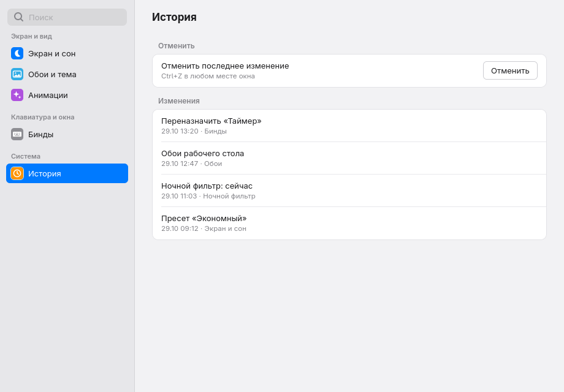
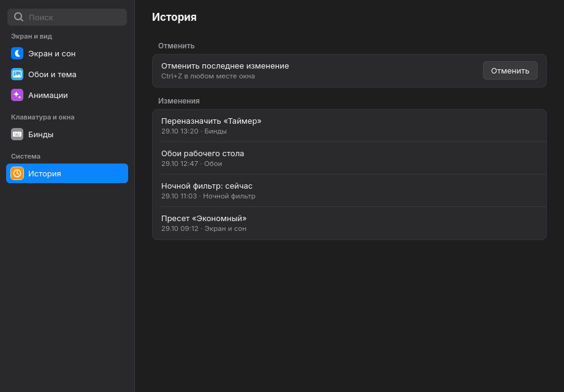

# settings-hub — «Настройки»

Окно «Настройки» в стиле macOS для рабочего стола на Hyprland: Python, GTK4 и
собственный стиль (без вида libadwaita). Программа всё время работает в фоне,
поэтому по клавише окно появляется меньше чем за полсекунды. В одном окне
собираются настройки, которые сейчас разбросаны по разным программам.

| Светлая | Тёмная |
|---|---|
|  |  |

## Что готово

Версия 1 делается по шагам. Сейчас готов **каркас**:

- фоновая программа и окно: сайдбар с поиском и цветными значками, справа —
  скруглённые группы строк; светлая и тёмная тема; управление с клавиатуры;
- поиск по страницам: без учёта регистра, «ё» = «е», набор в неверной
  раскладке («cjy» находит «Экран и сон»);
- История изменений с отменой: одно действие — одна группа пунктов;
- загрузка живых модулей других проектов под своими именами и по одной очереди
  применения на каждый источник настроек;
- `settings-open` — команда для клавиш, со всеми запасными путями;
- установка и удаление в песочнице.

Страницы «Экран и сон», «Обои и тема», «Анимации» и «Бинды» пока пустые
(«Раздел появится на следующем шаге»); «История» работает.

## Как устроено

- `app.py --daemon` запускает `Gtk.Application` с именем
  `io.github.whyslab.SettingsHub` на шине D-Bus и ждёт, спрятав окно. Класс
  окна — `settings-hub`.
- `bin/settings-open [страница]` просит работающую копию открыть страницу через
  `gdbus` (это быстрее запуска Python). Если копии нет — запускает её под
  замком (второе быстрое нажатие ждёт, а не запускает ещё одну). Если за 3 с
  копия не поднялась — убивает именно запущенный процесс и открывает старое окно
  этой страницы.
- Окно ничего не помнит: страница перечитывает свои источники при каждом показе.
- Esc гасится на нажатии и прячет окно на отпускании — зажатая клавиша не
  уходит в окно под ним.
- Клавиши: Ctrl+F — поиск, ↑/↓ — выбор, Enter — открыть, Tab — между сайдбаром
  и страницей, Esc — спрятать, Ctrl+Z — отменить последнюю правку.
- Вид не зависит от системной темы GTK: у процесса встроенная тема GTK, а
  `style/base.css` (грузится выше пользовательского `gtk.css`) использует только
  свои цвета и переменные `--sh-*`.

## Проверки

```
ruff check .
pytest tests/ -q              # как в CI; тесты live не запускаются
pytest tests/ -q -m live      # плюс проверка на установленных модулях машины
```

Скриншоты не трогают экран пользователя: `tools/shot.sh` поднимает свой Xvfb
на `:99` или выше, временный `HOME`, свою шину D-Bus и заглушки `hyprctl` и др.

## Установка

В этой версии — только в песочницу:

```
./install.sh --prefix /tmp/sandbox
./uninstall.sh --prefix /tmp/sandbox --purge
```

Всё, что создаёт установщик, записано в install-manifest; удаление убирает
ровно это, а свою строку в `hyprland.conf` — только если она там ровно одна.
